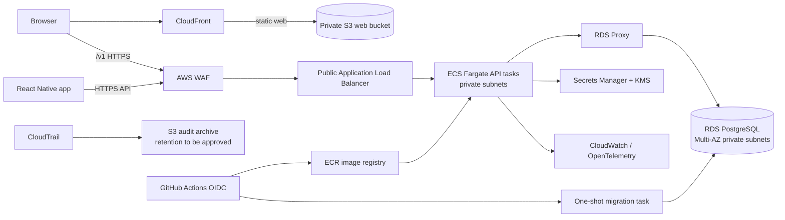

# Propuesta de arquitectura AWS (no desplegada)

**Estado:** propuesta para responder la Fase 4 de `docs/challenge.md`. No se creó infraestructura, no se publicaron clientes y no se probaron objetivos de disponibilidad, recuperación, capacidad o costo. Los objetivos RPO/RTO son metas iniciales para análisis, no compromisos ni garantías. No se afirma certificación ni cumplimiento regulatorio.

## Arquitectura propuesta

El diagrama es una propuesta de componentes y límites de red. El frontend web serviría archivos estáticos; la API sería el único componente de aplicación con acceso de escritura a PostgreSQL. Los servicios de despliegue y migración usarían permisos distintos a los del rol runtime.

## Cómputo de la API

**Propuesta: Amazon ECS con AWS Fargate**, con una imagen de contenedor de la API Express/Node.js detrás de un Application Load Balancer. Las tareas corren en subredes privadas y reciben tráfico únicamente desde el balanceador. El balanceador permite health checks y despliegues graduales; el autoscaling se configura según CPU, memoria y latencia observada, no con umbrales inventados.

- **Frente a App Runner:** Fargate ofrece control más directo sobre redes privadas, balanceo, tareas de migración puntuales y políticas por servicio. App Runner también podría servir para un prototipo simple, pero no es la opción de partida para separar con claridad API, migraciones y acceso de base de datos.
- **Frente a EKS:** Kubernetes añadiría operación del plano de control, upgrades y políticas que no se justifican para este monolito modular y su carga inicial.
- **Frente a Lambda + API Gateway:** Lambda sería viable para APIs sin conexiones largas, pero este servicio ya usa Express, transacciones PostgreSQL y un pool de conexiones. Elegirlo requeriría adaptar runtime, pooling, límites de duración y observabilidad; no es una mejora necesaria para el alcance actual.

Estas son decisiones de diseño para evaluación. Falta medir carga, latencia, tamaño de imagen, costo y necesidades operativas antes de seleccionar capacidad o mínimos/máximos de tareas.

## PostgreSQL, continuidad y recuperación

**Propuesta: Amazon RDS for PostgreSQL Multi-AZ**, en subredes privadas, cifrado con KMS y acceso de red exclusivo desde RDS Proxy y el servicio de migración autorizado. Mantener backups automáticos con point-in-time recovery y snapshots cifrados; definir una copia de recuperación en otra región según el análisis de impacto y costo.

- Multi-AZ cubre ciertos fallos de infraestructura de la instancia primaria; no sustituye backups ni una estrategia ante errores lógicos, borrado accidental o indisponibilidad regional.
- Habilitar monitoreo de almacenamiento, conexiones, latencia, locks, autovacuum y replicación/backup; probar restauraciones periódicas en un ambiente aislado.
- **Metas candidatas para revisión, no aprobadas:** RPO ≤ 5 minutos y RTO ≤ 60 minutos para pérdida de instancia en una región. La recuperación regional puede tener objetivos distintos. Deben validarse con producto, operaciones, costos y pruebas de recuperación antes de convertirse en requisitos.
- Las migraciones TypeORM se ejecutarían como tarea controlada de una sola instancia con rol migrator; las tareas runtime no tendrían permisos DDL. `synchronize` seguiría desactivado.
- La garantía de atomicidad y conciliación del ledger permanecería en PostgreSQL y en la transacción de la API; el despliegue no delegaría postings financieros a procesos asíncronos.

## Web y aplicación móvil

- **Web:** bucket S3 privado con versionado, accesible solo por CloudFront mediante Origin Access Control. CloudFront entrega los archivos estáticos; el path de API se enruta al balanceador. Invalidaciones y promoción entre ambientes se hacen desde CI, sin hacer público el bucket.
- **Móvil:** distribución futura con builds firmados y canales internos de prueba antes de tiendas; EAS es una opción de distribución, no parte de esta entrega. La app se configura con el endpoint HTTPS del ambiente y conserva tokens en Keychain/Keystore mediante SecureStore. No se debe incluir credencial, llave privada ni secreto de ambiente dentro del bundle.
- Los dominios, certificados TLS, CORS, política de caché, versiones soportadas y proceso de publicación quedan pendientes de aprobación operativa. Este repositorio no se publica a EAS ni a tiendas.

## Observabilidad y auditoría

- Enviar logs JSON de la API a CloudWatch con request ID, versión, ruta/resultado y latencia; aplicar redacción antes de exportar. No incluir contraseñas, tokens, OTP, CLABEs completas ni payloads financieros innecesarios.
- Instrumentar métricas y trazas con OpenTelemetry y exportarlas a CloudWatch/X-Ray. Alertas iniciales se definirían desde SLO acordados y pruebas de carga, no desde umbrales supuestos.
- CloudTrail registraría acciones del plano de control AWS. No sustituye la auditoría funcional de transferencias.
- Los `audit_events` del producto permanecen append-only en PostgreSQL según los permisos y migraciones de aplicación. Una exportación periódica cifrada a S3 con versionado/Object Lock puede evaluarse para retención independiente; duración, legal hold y acceso deben definirse con responsables legales/operativos antes de habilitarla.
- Definir catálogo de datos, acceso de soporte, retención y borrado conforme a una política aprobada. Esta propuesta no determina obligaciones regulatorias.

## CI/CD y separación de ambientes

GitHub Actions puede construir, probar y publicar la imagen a ECR. La autenticación con AWS se haría mediante OIDC y roles IAM de duración corta, sin llaves AWS persistentes en GitHub Secrets.

1. **CI:** `npm ci`, lint, typecheck, pruebas unitarias, contrato OpenAPI, PostgreSQL de prueba, E2E/visuales y builds. Publicar reportes y capturas con datos sintéticos enmascarados.
2. **Dev:** desplegar a un ambiente aislado con base propia y fixture explícita; no reutilizar bases de test ni datos reales.
3. **Staging:** reproducir topología de producción con datos sintéticos; probar migración hacia delante, smoke tests y restauración.
4. **Prod:** promover una imagen ya identificada por digest, aplicar migración con rol separado y desplegar gradualmente. Las condiciones de promoción y los responsables de aprobación deben definirse en la gobernanza del proyecto.

Cada ambiente tendría cuentas/roles, secretos, red, base y bucket separados. Las políticas IAM se limitarían a los recursos y acciones requeridos por cada job/servicio.

## Conexiones PostgreSQL al escalar

Cada tarea ECS usaría un pool pequeño y explícitamente configurado. El presupuesto total de conexiones se calcularía como `tareas máximas × conexiones por tarea`, más migraciones y operaciones, manteniéndose debajo del límite medido de RDS. RDS Proxy se propone para multiplexar conexiones y amortiguar cambios de escala; las transacciones largas o características de sesión pueden reducir la multiplexación y deben probarse con el driver y TypeORM reales.

El tamaño del pool, límites de espera, timeouts y capacidad de RDS no se fijan aquí: se derivan de pruebas de carga y de la concurrencia transaccional observada.

## Evolución ante un crecimiento de 100×

Primero mediría con datos representativos y perfiles separados de lecturas/escrituras. Luego, en este orden:

1. Escalar tareas de API sin exceder el presupuesto de conexiones; optimizar consultas, índices y límites de payload con planes reales.
2. Aumentar capacidad de RDS/almacenamiento y revisar IOPS, CPU, locks, autovacuum y conexiones antes de separar componentes.
3. Para lecturas históricas, evaluar réplica o un read model después de acordar tolerancia de consistencia y comportamiento de retraso. Saldos y decisiones de transferencia siguen leyéndose/escribiéndose contra la fuente autoritativa.
4. Evaluar particionamiento/archivo del ledger con pruebas de constraints, referencias y consultas; no aplicarlo sin demostrar que conserva conciliación y requisitos de retención.
5. Separar notificaciones o reportes no financieros mediante colas si la carga lo justifica. La transacción de ledger no se dividiría entre servicios sin un nuevo diseño de consistencia.

El crecimiento no implica por sí mismo migrar a microservicios ni garantiza capacidad lineal; cada paso requiere pruebas de carga, reconciliación y costo.

## Infraestructura como código y pendientes

**Propuesta: Terraform**, con módulos pequeños para red, ECS, RDS, proxy, buckets/CDN, observabilidad y roles; variables separadas por ambiente, revisión del plan en CI y estado remoto cifrado con versionado y locking. No se incluyen credenciales ni estado Terraform en el repositorio.

Antes de ejecutar esta propuesta faltan: decisión de cuenta/región, dominios/certificados, estimación de costo, arquitectura de red final, valores/SLO aprobados, política de retención, threat model, plan de recuperación probado y revisión independiente. No ejecutar AWS, EAS ni tiendas como parte de esta entrega local.
