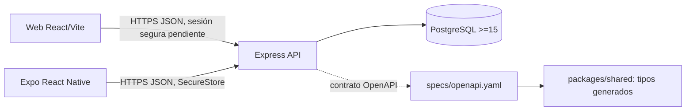

# Diseño inicial — producto autorizado; decisiones de política explicitadas

**Fuente:** `docs/challenge.md`. El usuario autorizó el desarrollo del producto obligatorio y aprobó los diseños Stitch como referencias visuales (2026-11-14; véase `docs/design-mapping.md`). Este documento separa requisitos, decisiones técnicas de implementación y política demo pendiente; los exports visuales no aprueban funciones externas ni claims regulatorios. El OpenAPI es el contrato de implementación coordinado, sujeto a los criterios REQ-*.

## Estado de decisiones

| Tema | Estado | Registro |
|---|---|---|
| Monorepo npm workspaces, API/web/mobile/shared | Decidido por BOOT-00 | Paquetes separados y dependencias compartidas minimizadas |
| API Express/TypeScript strict/TypeORM; PostgreSQL >=15 | Decidido por reto/BOOT-00 | TypeORM `synchronize:false` siempre |
| Web React/Vite/TypeScript; React Native + Expo | Decidido por restricciones solicitadas | No Next.js, prebuild/eject ni plataformas nativas innecesarias |
| Tipos desde OpenAPI hacia shared | Decidido para scaffold | Validación reusable sin imports de TypeORM, módulos Node ni secretos en web/móvil |
| Cuenta MXN creada al registro; fixture demo con dos cuentas propias y asientos de apertura contra clearing | Aprobado por usuario para esta implementación (2026-11-14) | Seed demo idempotente y claramente local; importes fixture configurable, nunca política ni fondos reales |
| Solo cuentas/beneficiarios de la plataforma; rechazar origen igual a destino | Delimitación aceptada del reto y del alcance | No hay pagos SPEI/bancos externos; beneficiario CLABE válida debe resolver a una cuenta interna |
| Dinero como centavos enteros `bigint`, JSON `amountMinor` decimal-string | Decisión de implementación | Sin aritmética `float`; precisión MXN de dos decimales, >2 rechazada sin redondeo silencioso; máximo validado antes de `bigint` |
| Límite diario por usuario/fecha de negocio en zona configurada | Política configurable, valores pendientes de aprobación de producto | Zona demo `America/Mexico_City`, límite demo 20,000 MXN/día ilustrativo desde env; producción requiere valor/zona explícitos |
| OTP sobre 5,000 MXN | Política configurable, valor ilustrativo pendiente | Umbral demo desde env (`5,000 MXN` como ejemplo, no exigencia aprobada); OTP simulado y ligado a un intento, sin proveedor externo ni logging del código |
| Contraseña argon2id/bcrypt, JWT corto y refresh rotativo | Requisito obligatorio; parámetros de operación configurables | Refresh web en cookie HttpOnly/Secure/SameSite con CSRF/origin checks; access web solo en memoria. Móvil usa SecureStore. Nunca `localStorage`/AsyncStorage para tokens |
| Ledger inmutable y saldo materializado conciliable | Decisión de implementación de integridad | Cada posting balanceado y saldo se actualiza en la misma transacción; contra-cuenta clearing; conciliación de apertura; el saldo no sustituye el ledger |
| Idempotencia, locks y límite concurrente | Decisión de implementación técnica | Misma key+payload devuelve mismo intento; payload distinto conflictúa; locks deterministas de cuentas y fila usuario/día; retry serialización acotado |
| Límites exactos, zona productiva, máximo de cantidad, OTP expiry/retries/lockout y datos seed | Pendiente de aprobación para producción | Configurables; fixture de demo no cierra estas políticas |
| Auditoría append-only y balance de asientos impuesto por BD | Requisito futuro explícito | Proponer rol escritor sin UPDATE/DELETE, FK, constraints diferibles o trigger; validar implicaciones operativas |
| Idempotencia y locks | Requisito futuro explícito | Diseño propuesto abajo; aislamiento/transacción final pendiente de revisión |

## Arquitectura propuesta



El backend se organiza por módulos/capas de auth, accounts, beneficiaries, transfers, ledger/history y seguridad; la lógica de dominio no reside en handlers. Web/móvil consumen tipos generados y validación portable. El backend aplica autorización por owner antes de cargar/usar recursos.

## Modelo ER de implementación (migraciones del producto)

```mermaid
erDiagram
  USER o|--o{ ACCOUNT : owns
  USER ||--o{ BENEFICIARY : registers
  ACCOUNT ||--o{ TRANSFER : source
  ACCOUNT ||--o{ TRANSFER : destination
  BENEFICIARY o|--o{ TRANSFER : payee_reference
  TRANSFER o|--|| LEDGER_TRANSACTION : posts
  LEDGER_TRANSACTION ||--|{ LEDGER_ENTRY : balances
  LEDGER_ENTRY }o--|| ACCOUNT : posts_to
  USER ||--o{ DAILY_LIMIT_USAGE : consumes
  USER ||--o{ REFRESH_SESSION : authenticates
  USER ||--o{ AUDIT_EVENT : acts
  TRANSFER ||--o| IDEMPOTENCY_RECORD : deduplicates
  ACCOUNT ||--o{ BENEFICIARY : resolves_to
  USER { uuid id PK }
  ACCOUNT { uuid id PK uuid owner_id FK bigint balance_minor currency account_kind varchar clabe_ciphertext varchar clabe_lookup_hash }
  BENEFICIARY { uuid id PK uuid owner_id FK uuid destination_account_id FK varchar clabe_ciphertext varchar clabe_lookup_hash }
  TRANSFER { uuid id PK uuid owner_id FK uuid source_account_id FK uuid destination_account_id FK bigint amount_minor status }
  LEDGER_TRANSACTION { uuid id PK uuid transfer_id FK source_type reference created_at }
  LEDGER_ENTRY { uuid id PK uuid ledger_transaction_id FK uuid account_id FK bigint signed_amount_minor }
  DAILY_LIMIT_USAGE { uuid id PK uuid owner_id FK date business_date bigint outgoing_minor }
  IDEMPOTENCY_RECORD { uuid id PK uuid user_id FK varchar key_hash uuid transfer_id FK }
  REFRESH_SESSION { uuid id PK uuid user_id FK varchar token_hash timestamptz expires_at }
  AUDIT_EVENT { uuid id PK uuid actor_id FK varchar action jsonb created_at }
```

Los tipos/constraints exactos se materializan en migraciones TypeORM. Cuenta `clearing` puede carecer de owner y tener saldo firmado; cuentas customer deben permanecer no-negativas. CLABE se valida por checksum; almacenamiento usa ciphertext autenticado más HMAC lookup hash con llave de entorno separada, y salida enmascarada salvo CLABE de cuenta propia. El beneficiario referencia la cuenta interna ya resuelta. `ledger_entries` son append-only y se verifica suma cero por `ledger_transaction_id` usando constraint trigger diferido; cada transfer completed tiene una ledger transaction, y la apertura demo también usa una transacción de ledger con contra-posting clearing. `audit_events` append-only por privilegios. Migrator/runtime DB roles siguen separados. El diagrama no agrega SPEI, bancos externos, KYC ni biometría.

## Dinero, concurrencia e idempotencia

- Representar MXN en centavos enteros (`bigint` dentro de PostgreSQL); API puede serializar `amountMinor` como cadena decimal para no perder precisión en JavaScript. Propuesta: cantidades positivas y tope explícito derivado de rango acordado; no permitir conversión a `Number` para aritmética. Alternativamente decimal-string validado; elegir antes de aprobar contrato.
- Cada transferencia debita y acredita asientos opuestos dentro de transacción. Invariante de suma cero se debe imponer en BD mediante constraint/trigger deferred o proceso de postings con control equivalente; comprobar y justificar según PostgreSQL. `CHECK` evita saldo negativo; FKs y unique garantizan referencias e idempotency.
- Orden determinista: bloquear filas de cuenta por UUID ascendente con `SELECT ... FOR UPDATE`; verificar autorización, estado, saldo y límite del día bajo bloqueo; escribir transferencia, entries, saldo y auditoría en una única transacción. Evaluar serialización de límite por usuario/día con fila de control o advisory lock transaccional keyed por usuario/día. Definir retry acotado para SQLSTATE de serialización/deadlock, manteniendo misma llave idempotente.
- Clave idempotente única por usuario + operación, persistir hash de payload canónico y resultado; repetición exacta retorna la respuesta previamente persistida, mismo key con payload distinto retorna conflicto. La llave se genera una vez al iniciar intento UI; retry de red móvil reutiliza esa llave y consulta estado.
- Límite diario por zona IANA de usuario/producto aprobada y ventanas [inicio, fin) convertidas a UTC; transacciones que cruzan medianoche se asignan con timestamp de aceptación definido. Impedir doble consumo concurrente dentro de la ventana.
- Auditoría append-only con rol separado sin UPDATE/DELETE y controles adicionales de retención/backup. Ningún dato sensible plano en logs.

## Seguridad y autenticación

- Hash de contraseña Argon2id (parámetros versionados); access JWT breve; refresh token opaco/rotativo almacenado como hash, detección de reutilización y revocación. Lifetimes por configuración, valores demo no se declaran política legal.
- Móvil: tokens en SecureStore (Keychain/Keystore), ocultar app switcher/background; no AsyncStorage para credenciales.
- Web: access token solo en memoria; refresh por cookie `HttpOnly; Secure` en producción, `SameSite=Lax/Strict` según flujo, CSRF token/origin verification y CORS allowlist. Sin persistencia de access/refresh en `localStorage`.
- Validación Zod/contrato portable sin acoplar web/móvil a Node/TypeORM. Rate limit, respuestas genéricas, autorización por propietario, request ID, logs JSON con redacción y secretos por entorno.
- Acceso a recurso ajeno responde 404 genérico o política equivalente para evitar enumeración; definir uniformemente en API.

## Errores y API

Contrato OpenAPI: [`openapi.yaml`](openapi.yaml) (OpenAPI 3.1.0 borrador). Respuestas de error `application/problem+json`, basadas en RFC 7807/9457 compatible: `type`, `title`, `status`, `detail` no sensible, `instance`, `requestId`, y `errors` opcional para campos. Propuesta de códigos: 400 validación, 401 no autenticado, 403 política, 404 recurso no visible, 409 idempotencia/estado/conflicto, 422 saldo/límite/regla financiera, 429 rate limit, 500 genérico. El contrato no es aprobación funcional ni evidencia de endpoints existentes.

## Matriz de pantallas y estados aprobados

La revisión visual está **aprobada como referencia**. Correspondencia completa de exports/estados/rutas/fases: `docs/design-mapping.md`. Ninguna parte de esta matriz aprueba integraciones externas ni claims de los exports.

| Cliente | Pantalla | Estados mínimos a diseñar | Estado |
|---|---|---|---|
| Web | Registro/Login | idle, validation, submitting, email conflict, success, invalid credentials, rate limited, session refresh/revoked | Implementar Fase 1 |
| Web | Resumen cuentas | loading, populated, zero balance, empty/error | Implementar Fase 1 |
| Web | Historial | loading, populated, empty, no results, filter, cursor loading, recoverable error | Implementar Fase 4 |
| Web | Alta/directorio beneficiarios | loading/list, empty, search, invalid CLABE, duplicate, destination not internal, saving/error/success | Implementar Fase 2 |
| Web | Transferir/revisión | draft beneficiary/own-account, validation, insufficient, daily limit, review, submitting, OTP, uncertain, receipt/rejected | Implementar Fase 3–4 |
| Móvil | Login/cuentas | idle, submitting, error, SecureStore session, loading, accounts/zero-balance, offline/error | Implementar Fase 1 |
| Móvil | Últimos 20/detalle | loading, populated, empty, offline/error, detail | Implementar Fase 4 |
| Móvil | Elegir beneficiario/datos/revisión | list/search, draft, validation, insufficient, daily limit, confirm/OTP | Implementar Fase 2–3 |
| Móvil | Procesando/recuperación | sending, unknown/offline, retry with same key, server status, complete/rejected | Implementar Fase 3 |
| Móvil | Privacidad background | foreground, obscured app-switcher/snapshot, resume, session expired/re-auth | Implementar Fase 4 |
| Compartido | Sesión | access expired, refresh, revoked/reuse, re-auth | Implementar Fase 1/4 |

## Evidencia de rendimiento pendiente

No se inventa salida ni plan `EXPLAIN ANALYZE`. Durante Fase 4 generar seed reproducible de al menos 100,000 movimientos en `wallet_test`, ejecutar consulta representativa filtrada por usuario/tipo/fecha y cursor keyset con `EXPLAIN (ANALYZE, BUFFERS)`, guardar comando, versión/configuración, cardinalidad, índices y salida real sanitizada; revisar índices y latencia. Pendiente.
