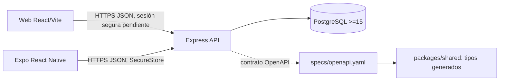

# Diseño inicial — borrador sujeto a revisión

**Fuente:** `docs/challenge.md`. Este documento separa obligaciones textuales, propuestas de diseño y pendientes de decisión. `specs/openapi.yaml` es contrato de diseño para requisitos futuros; no acredita endpoints implementados. El único alcance autorizado ahora es BOOT-00.

## Estado de decisiones

| Tema | Estado | Registro |
|---|---|---|
| Monorepo npm workspaces, API/web/mobile/shared | Decidido por BOOT-00 | Paquetes separados y dependencias compartidas minimizadas |
| API Express/TypeScript strict/TypeORM; PostgreSQL >=15 | Decidido por reto/BOOT-00 | TypeORM `synchronize:false` siempre |
| Web React/Vite/TypeScript; React Native + Expo | Decidido por restricciones solicitadas | No Next.js, prebuild/eject ni plataformas nativas innecesarias |
| Tipos desde OpenAPI hacia shared | Decidido para scaffold | Validación reusable sin imports de TypeORM, módulos Node ni secretos en web/móvil |
| Dinero como entero de centavos, representación JSON decimal-string o minor units | Propuesto | Definir rango máximo y forma pública antes de aprobar API; jamás `float` |
| Cuentas automáticas al registro; demo con dos cuentas propias y seed compensado | Supuesto pendiente | No implementado; seed financiero requiere decisión y autorización |
| Beneficiarios internos; rechazar mismo origen/destino | Supuesto pendiente | La prueba habla de transferencias internas y cuenta propia; confirmar semántica exacta |
| Límite diario por usuario en `America/Mexico_City` | Supuesto pendiente | Zona y agregación requieren aprobación explícita |
| Límite 20,000 MXN/día y OTP sobre 5,000 MXN | Valores ilustrativos pendientes | No provienen del reto ni están aprobados; no parametrizar como política definitiva |
| OTP asociado al intento, uso único y rechazo >2 decimales | Propuesto/pendiente | Confirmar expiración, reintentos y formato |
| JWT corto + refresh rotativo; contraseña argon2/bcrypt; rate limit | Requisito futuro explícito | Selección de cookie/token web, duración, revocación y CSRF pendiente |
| Auditoría append-only y balance de asientos impuesto por BD | Requisito futuro explícito | Proponer rol escritor sin UPDATE/DELETE, FK, constraints diferibles o trigger; validar implicaciones operativas |
| Idempotencia y locks | Requisito futuro explícito | Diseño propuesto abajo; aislamiento/transacción final pendiente de revisión |

## Arquitectura propuesta



El backend se organiza por configuración, middleware HTTP, rutas de health y adaptador TypeORM; futura lógica de dominio no residirá en handlers. Web/móvil consumen los tipos generados y validaciones portables. Ningún esquema financiero se crea en BOOT-00.

## Modelo ER futuro propuesto (no migrado)

```mermaid
erDiagram
  USER ||--o{ ACCOUNT : owns
  USER ||--o{ BENEFICIARY : registers
  ACCOUNT ||--o{ TRANSFER : source
  ACCOUNT ||--o{ TRANSFER : destination
  BENEFICIARY o|--o{ TRANSFER : payee_reference
  TRANSFER ||--|{ LEDGER_ENTRY : posts
  USER ||--o{ REFRESH_SESSION : authenticates
  USER ||--o{ AUDIT_EVENT : acts
  TRANSFER ||--o| IDEMPOTENCY_RECORD : deduplicates
  USER { uuid id PK }
  ACCOUNT { uuid id PK uuid owner_id FK bigint balance_minor currency }
  BENEFICIARY { uuid id PK uuid owner_id FK varchar clabe_ciphertext }
  TRANSFER { uuid id PK uuid source_account_id FK uuid destination_account_id FK bigint amount_minor }
  LEDGER_ENTRY { uuid id PK uuid transfer_id FK uuid account_id FK bigint amount_minor }
  IDEMPOTENCY_RECORD { uuid id PK uuid user_id FK varchar key_hash uuid transfer_id FK }
  REFRESH_SESSION { uuid id PK uuid user_id FK varchar token_hash timestamptz expires_at }
  AUDIT_EVENT { uuid id PK uuid actor_id FK varchar action jsonb created_at }
```

ER propuesto, no aprobado: decidir entre saldo materializado conciliable y ledger como fuente de verdad, representación de beneficiario cifrado/enmascarado, política de retención, reversas, estados y referencias. No crear esas tablas antes de design review.

## Dinero, concurrencia e idempotencia

- Representar MXN en centavos enteros (`bigint` dentro de PostgreSQL); API puede serializar `amountMinor` como cadena decimal para no perder precisión en JavaScript. Propuesta: cantidades positivas y tope explícito derivado de rango acordado; no permitir conversión a `Number` para aritmética. Alternativamente decimal-string validado; elegir antes de aprobar contrato.
- Cada transferencia debita y acredita asientos opuestos dentro de transacción. Invariante de suma cero se debe imponer en BD mediante constraint/trigger deferred o proceso de postings con control equivalente; comprobar y justificar según PostgreSQL. `CHECK` evita saldo negativo; FKs y unique garantizan referencias e idempotency.
- Orden determinista: bloquear filas de cuenta por UUID ascendente con `SELECT ... FOR UPDATE`; verificar autorización, estado, saldo y límite del día bajo bloqueo; escribir transferencia, entries, saldo y auditoría en una única transacción. Evaluar serialización de límite por usuario/día con fila de control o advisory lock transaccional keyed por usuario/día. Definir retry acotado para SQLSTATE de serialización/deadlock, manteniendo misma llave idempotente.
- Clave idempotente única por usuario + operación, persistir hash de payload canónico y resultado; repetición exacta retorna la respuesta previamente persistida, mismo key con payload distinto retorna conflicto. La llave se genera una vez al iniciar intento UI; retry de red móvil reutiliza esa llave y consulta estado.
- Límite diario por zona IANA de usuario/producto aprobada y ventanas [inicio, fin) convertidas a UTC; transacciones que cruzan medianoche se asignan con timestamp de aceptación definido. Impedir doble consumo concurrente dentro de la ventana.
- Auditoría append-only con rol separado sin UPDATE/DELETE y controles adicionales de retención/backup. Ningún dato sensible plano en logs.

## Seguridad y autenticación futura

- Hash de contraseña con Argon2id (propuesta) y parámetros calibrados; access JWT breve; refresh token opaco/rotativo almacenado como hash, detección de reutilización y revocación.
- Móvil: tokens en SecureStore (Keychain/Keystore), ocultar app switcher/background; no AsyncStorage para credenciales.
- Web pendiente de decidir: preferir BFF/cookie `HttpOnly; Secure; SameSite` con protección CSRF y CORS restringido; no persistir JWT en `localStorage`. Si cliente directo, justificar CSRF/refresh y origen permitido antes de implementar.
- Validación Zod/contrato portable sin acoplar web/móvil a Node/TypeORM. Rate limit, respuestas genéricas, autorización por propietario, request ID, logs JSON con redacción y secretos por entorno.
- Acceso a recurso ajeno responde 404 genérico o política equivalente para evitar enumeración; definir uniformemente en API.

## Errores y API

Contrato OpenAPI: [`openapi.yaml`](openapi.yaml) (OpenAPI 3.1.0 borrador). Respuestas de error `application/problem+json`, basadas en RFC 7807/9457 compatible: `type`, `title`, `status`, `detail` no sensible, `instance`, `requestId`, y `errors` opcional para campos. Propuesta de códigos: 400 validación, 401 no autenticado, 403 política, 404 recurso no visible, 409 idempotencia/estado/conflicto, 422 saldo/límite/regla financiera, 429 rate limit, 500 genérico. El contrato no es aprobación funcional ni evidencia de endpoints existentes.

## Matriz de pantallas y estados

Todas las filas están **pendientes de diseño/revisión** y no se construyen en BOOT-00. Estado general: `DESIGN_REVIEW_REQUIRED`.

| Cliente | Pantalla | Estados mínimos a diseñar | Estado |
|---|---|---|---|
| Web | Registro | idle, validación, submitting, éxito, error | Pendiente |
| Web | Login | idle, submitting, error, throttled | Pendiente |
| Web | Resumen cuentas | loading, populated, empty, error | Pendiente |
| Web | Historial | loading, populated, empty, filter, next-page, error | Pendiente |
| Web | Alta beneficiario | idle, invalid CLABE, submitting, success, error | Pendiente |
| Web | Transferencia | draft, validation, submitting, insufficient, OTP, confirmed, receipt, uncertain/error | Pendiente |
| Móvil | Login | idle, submitting, error, secure-session | Pendiente |
| Móvil | Saldo/cuentas | loading, populated, empty, offline, error | Pendiente |
| Móvil | Últimos 20 movimientos | loading, populated, empty, offline, error | Pendiente |
| Móvil | Transferencia beneficiario | draft, validation, submitting, offline/unknown, retry-same-key, confirmed, rejected | Pendiente |
| Móvil | Protección background | foreground, obscured, locked/resume | Pendiente |
| Compartido | Sesión expirada | refresh, revoked, re-authentication | Pendiente |

## Evidencia de rendimiento pendiente

No se inventa salida ni plan `EXPLAIN ANALYZE`. Después de diseño y autorización: generar seed reproducible de al menos 100,000 movimientos, ejecutar consulta representativa filtrada por usuario/tipo/fecha y cursor keyset con `EXPLAIN (ANALYZE, BUFFERS)`, guardar comando, versión/configuración, cardinalidad, índices y salida real sanitizada; revisar índices y latencia. Pendiente completamente.
